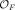
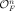
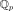

# Quadratic forms over number fields in Lean 4

[](https://github.com/jonhanke/quadratic-forms-lean/actions/workflows/build.yml) [](https://doi.org/10.5281/zenodo.23509792)

A Lean 4 library (built on Mathlib v4.35.0) for the arithmetic theory of quadratic forms over number fields. The Lean library is called `QuadFormsKB`.

- **Literature statements**: each result from a paper or book is a Lean declaration tagged
  `@[kb "<source key>" "<locator>"]`.
- **Definition equivalences**: competing definitions live side by side in `Defs/`, with
  their comparison (equal, strictly contained, counterexample) proved in `Equiv/`.
- **What is proved**: every theorem is checked by the Lean kernel; the only `sorry`s in the
  repository are the deliberate ones in [`Challenge.lean`](Challenge.lean), which states the headline
  results without proofs. The CI workflow builds the library and checks that the headline theorems depend only
  on the standard axioms `propext`, `Classical.choice` and `Quot.sound`
  ([scripts/check_axioms.lean](scripts/check_axioms.lean)), and runs `lake comparator` to check
  the proved statements against [`Challenge.lean`](Challenge.lean).

## Highlights

Every result listed here is checked by the Lean kernel with only the standard axioms
(`propext`, `Classical.choice`, `Quot.sound`) and depends on no unproved input.

- **[Siegel's theorem for totally positive definite quadratic lattices representing numbers over totally real number fields](docs/results/siegel-totally-real.md):** for every totally positive definite quadratic lattice $`L`$ over  of every rank $`n`$, in every genus (including genera of non-free lattices), and every totally positive $`m \in`$ , the genus average $`\sum_{L'} r_{L'}(m)/|\mathrm{O}(L')| \big/ \sum_{L'} 1/|\mathrm{O}(L')|`$ equals the product of the local densities of $`L`$ (regularized by $`L(1,\chi)`$ when $`n = 2, 3`$; over ℚ in rank $`3`$ also in the natural order of the primes).
- **[Tamagawa number and mass formula over totally real number fields](docs/results/tamagawa-mass-formula.md):** $`\tau(\mathrm{SO}(Q)) = 2`$ and the Smith–Minkowski–Siegel mass formula (Siegel's general form, as an Euler product of local densities) for totally positive definite quadratic lattices of every rank over every totally real number field.
- **[Hilbert reciprocity over number fields](docs/results/hilbert-reciprocity.md):** $`\prod_v (a,b)_v = 1`$ for all $`a, b \in F^\times`$ and every number field $`F`$, by a purely local proof via the Weil index, independent of class field theory. (Tau Ceti proves it through class field theory and the Brauer group.)
- **[Hasse–Minkowski over number fields](docs/results/hasse-minkowski-number-fields.md):** a quadratic form over a number field is isotropic, represents $`c`$, or is isometric to another form if and only if this holds over every completion $`F_v`$. (Tau Ceti has the rank-4 and rank-≥5 induction steps, conditional on the lower ranks.)
- **[Hasse–Minkowski over ℚ](docs/results/hasse-minkowski-rationals.md)**, for forms in any number of variables.
- **[Tamagawa numbers of SO(V) over every number field](docs/results/tamagawa-table.md)** (new in 0.2.0): $`\tau(\mathrm{SO}(V)) = 2`$ for every nondegenerate quadratic space of dimension $`n \ge 3`$ over every number field (any signature, isotropic or not, complex places allowed); $`\tau = 2`$ for anisotropic and $`\tau = 1`$ for isotropic binary spaces, with Weil's convergence factors; $`\tau = 1`$ in dimension $`1`$.
- **[Siegel's formula for indefinite forms over every number field](docs/results/siegel-indefinite.md)** (new in 0.2.0): the measure form of Siegel's formula for numbers and for forms represented by forms of any signature, for every rank of the stabilizer, including Siegel's excluded case of an isotropic binary stabilizer (regularized by the residue of $`\zeta_F`$); and Siegel's formula for definite forms representing forms over totally real fields.
- **[Exact mass formulas](docs/results/mass-formulas.md)** (new in 0.4.0): the Conway–Sloane mass formula over ℤ from the genus symbols; Shimura's exact mass formula for $`\mathrm{SO}`$ over totally real number fields (Gan, Hanke and Yu), odd and even $`n`$; Hanke's exact mass formula over every number field, in a corrected general form.
- **[Classification of lattices and genera](docs/results/classification.md)** (new in 0.4.0): O'Meara 93:28 and 93:29 at the dyadic primes of number fields; Conway–Sloane's Theorem 18 on automorphous numbers at every prime; the genus of a positive definite integral lattice from its discriminant form (Conway–Sloane 1988, Lemmas 2 and 4); and (new in 0.4.1) Watson's theorem: every genus of positive definite integer-valued forms in $`n > 11`$ variables has at least two classes.
- **[Quaternion orders, even unimodular lattices and sums of squares](docs/results/quaternions-lattices-squares.md)** (new in 0.5.0): Voight's Theorem 15.5.5 (an order of a quaternion algebra over a number field is maximal exactly when its discriminant is the product of the finite ramified primes), Voight's Main Theorem 22.4.1 (the bijection between similarity classes of nondegenerate ternary quadratic forms and quaternion orders over a principal ideal domain, 2 ≠ 0), the Eichler mass formula for maximal orders over ℚ and over totally real number fields, the existence of even unimodular lattices exactly in dimensions divisible by 8 (with finitely many classes), Jacobi's four-squares formula, Cauchy's polygonal number theorem and Sprague's theorem on sums of distinct squares.
- **[Classical cases over ℚ](docs/results/classical-cases.md)** (new in 0.2.0): Gauss's three-squares theorem, Jacobi's two-squares theorem and Dirichlet's theorem for $`x^2 - 2y^2`$, from Siegel's formula with explicit constants; and (new in 0.2.1) the number of representations of $`m \ne 0`$ by $`xy`$ modulo $`\pm1`$ is the number of divisors of $`|m|`$, from Siegel's formula in its excluded isotropic binary case.


**Main statements.** To check what is claimed, read one file: [`Challenge.lean`](Challenge.lean) states the results above, with a docstring for each and a list of the library definitions the statements use; every proof there is a deliberate `sorry`. Each headline also states the finiteness and convergence facts (finite genus, finite automorphism groups, convergent products, existence of $`L_F(1,\chi)`$) that make its sums and infinite products meaningful, so that no term relies on a Lean default value (since 0.2.1 this includes the finiteness of the number of proper classes in the genus for the indefinite Siegel formulas). [`Solution.lean`](Solution.lean) proves the same statements by appeal to the library theorems, and `lake comparator` (configured by [`comparator.json`](comparator.json)) checks that each proved statement is exactly the one in `Challenge.lean` and uses only the standard axioms. [`formalization.yaml`](formalization.yaml) records the scope, sources, divergences from the literature, provenance and review status in the [formalization.yaml](https://github.com/mathlib-initiative/formalization.yaml) format.

## What's new in 0.5.0

- **Five new books**: J. Voight, *Quaternion Algebras* (2021); G. Shimura, *Arithmetic and Analytic Theories of Quadratic Forms and Clifford Groups* (2004); Y. Kitaoka, *Arithmetic of Quadratic Forms* (1993); G. Chenevier and J. Lannes, *Automorphic Forms and Even Unimodular Lattices* (2019); and C. J. Moreno and S. S. Wagstaff, Jr., *Sums of Squares of Integers* (2005). For each, a [statement map](docs/results/books/README.md) lists the central results of the book that are stated in Lean, with the Lean declarations and their status (proved, proved in part, conditional on a named input, or stated as a named proposition): Voight 31 results (18 proved, 3 in part), Shimura 34 (20 proved, 5 in part), Kitaoka 47 (23 proved, 8 in part), Chenevier–Lannes 23 (4 proved, 5 in part), Moreno–Wagstaff 28 (26 proved).
- **Eight new headlines** (56 in total, the 48 headlines of 0.4.1 unchanged; see [quaternion orders, lattices and sums of squares](docs/results/quaternions-lattices-squares.md)): Voight's Theorem 15.5.5 (an order of a quaternion algebra over a number field is maximal exactly when its discriminant is the product of the finite ramified primes), Voight's Main Theorem 22.4.1 (the bijection between similarity classes of nondegenerate ternary quadratic forms and quaternion orders over a principal ideal domain, 2 ≠ 0), the Eichler mass formula for maximal orders over ℚ and over totally real number fields, the existence of even unimodular lattices exactly in dimensions divisible by 8 (with finitely many classes), Jacobi's four-squares formula, Cauchy's polygonal number theorem and Sprague's theorem on sums of distinct squares.
- The headline statements added in releases 0.2.0 to 0.5.0 are still **not yet reviewed** by a human (see Provenance).
- **Known restrictions** of the new headlines, stated in their docstrings and hypotheses:
  - Theorem 15.5.5 is proved for orders that are free of rank 4 over the ring of integers (automatic when it is a principal ideal domain); the general case, with a pseudo-basis, is not yet formalized.
  - Main Theorem 22.4.1 is proved over a principal ideal domain whose fraction field has 2 ≠ 0; the book states it over a Dedekind domain.
  - The Eichler mass formulas are proved for maximal orders containing the order generated by i and j, over ℚ and over totally real number fields whose ring of integers is a principal ideal domain.
  - Sprague's theorem: the book states 32 exceptions, but its list has 31; the formalization uses the list.

## What's new in 0.4.1

- **Watson's theorem** (G. L. Watson, "The class-number of a positive quadratic form", Proc. London Math. Soc. (3) 13 (1963), 549–576, Theorem 1): every genus of positive definite integer-valued forms in $`n > 11`$ variables has at least two classes. A new headline (`watson_twoClasses`; 48 in total, the 47 headlines of 0.4.0 unchanged); Cassels quotes the theorem without proof in Appendix A, and its book map now has 501 results proved and none conditional.
- The headline statements added in releases 0.2.0 to 0.4.1 were **not yet reviewed** by a human at the time of this release (see Provenance).

## What's new in 0.4.0

- **Nine new headlines** (47 in total); the 38 headlines of 0.3.0 are unchanged.
- **The Conway–Sloane mass formula over ℤ from the genus symbols** ([mass formulas](docs/results/mass-formulas.md)): the mass of a positive definite integral form in $`n \ge 3`$ variables is the standard mass times the ratios of the $`p`$-masses of its genus symbols to the standard $`p`$-masses, including $`p = 2`$, where the paper states the formula without proof (`massFormula_genusSymbols`).
- **Shimura's exact mass formula for SO**, as computed by Gan, Hanke and Yu, over every totally real number field, for odd and for even $`n`$ (`shimuraMass_odd`, `shimuraMass_even`).
- **Hanke's exact mass formula over every number field, in corrected general form** (`hankeMass_numberField`): Theorem 5.1 of the 2005 paper as printed omits Shimura's hypothesis on the determinant for odd $`n`$ and is false without it; the headline holds for every maximal lattice, with the local factors of Gan, Hanke and Yu at the primes where that hypothesis fails.
- **Conway–Sloane, Chapter 15, Theorem 18 at every prime** ([classification](docs/results/classification.md)): the $`p`$-adically automorphous numbers are the products of an even number of norms of $`p`$-adic root vectors, at $`p = 2`$ included (`automorphous_iff_rootVectors`).
- **O'Meara 93:28 and 93:29**, the classification of lattices at the dyadic primes and at the 2-adic primes of number fields, are now headlines (`dyadicClassification`, `twoAdicClassification`).
- **Conway–Sloane 1988, Lemmas 2 and 4**: two positive definite integral lattices are in the same genus if and only if they have the same type and isomorphic discriminant forms (`sameGenus_iff_discIso`, `sameGenus_iff_discIso_one`).
- **Four books complete**: Cassels, *Rational Quadratic Forms*; O'Meara, *Introduction to Quadratic Forms*; Conway–Sloane, *Sphere Packings, Lattices and Groups*, Chapter 15; and Conway–Sloane, *Low-dimensional lattices IV: the mass formula* (1988). Item-by-item maps from each book to the Lean declarations give the status of every item ([book maps](docs/results/books/README.md)): Cassels, 500 results proved and 1 conditional on a named input (Watson's theorem, quoted without proof in Appendix A, that every genus of positive definite forms in $`n > 11`$ variables has at least two classes); O'Meara, 571 proved and none open; Conway–Sloane, Chapter 15, 115 proved; Conway–Sloane 1988, 57 proved. The remaining items are definitions, out of scope, or (two in Chapter 15) not formalized.
- **Tartakowsky's theorem for quaternary forms** (Cassels, Chapter 11, Lemma 9.2 and Theorem 1.6 for $`n = 4`$): a positive definite classically integral form in 4 variables primitively represents over ℤ every sufficiently large integer that it primitively represents over every $`\mathbb Z_p`$ (`QuadFormsKB.Cassels.Ch11L92.tartakowskyClassicalAt_four_holds`).
- **Unimodular lattices up to dimension 13** (O'Meara 106, text 7, after Kneser, stated in the book without proof): for $`1 \le n \le 13`$ the unimodular lattices on the positive definite space $`I_n`$ over ℚ are, up to isometry, $`\mathbb Z^n`$, $`E_8 \perp \mathbb Z^{n-8}`$ and $`E_{12} \perp \mathbb Z^{n-12}`$ (O'Meara's notation), proved by the mass formula (`QuadFormsKB.Lattices.omeara106_r38`).
- **O'Meara 101:8a**: over a global function field of characteristic not 2, the spinor norms of the rotations of a regular quadratic space of dimension $`n \ge 3`$ are all of $`F^\times`$ (`QuadFormsKB.OMeara.omeara101_8a`).
- The headline statements added in releases 0.2.0 to 0.4.0 were **not yet reviewed** by a human at the time of this release (see Provenance).

## What's new in 0.3.0

- **Three new headlines** (38 in total): $`\tau(\mathrm{SO}(Q)) = 2`$ and the Smith–Minkowski–Siegel mass formula for ternary totally positive definite forms over every totally real number field (`tamagawa_two_totallyReal_ternary`, `massFormula_totallyReal_ternary`; earlier releases stated them for $`n \ge 4`$), and Siegel's formula for positive definite ternary forms over ℤ with the Euler product in the natural order of the primes (`siegel_ternary_rat_natural`).
- **Ternary Siegel formula, natural order:** over ℚ in rank $`3`$ the headline reads the product in the natural order of the primes; over a totally real field $`F`$ it is the regularized form, since the natural-order reading over $`F`$ needs the prime ideal theorem for Hecke characters, which is proved in a separate library.
- **Local classification at the dyadic primes:** O'Meara's Theorem 93:28 (classification of lattices over a dyadic local field) over the completion of every number field at every dyadic prime, and Theorem 93:29 over every 2-adic completion, unconditionally.
- **The Siegel–Weil formula in degree one** over totally real number fields, for diagonal totally positive definite forms in $`n = 2m \ge 6`$ variables: the Siegel Eisenstein series at $`s_0 = m - 1`$ equals the weighted average of the theta series over the classes of the genus (unconditional when $`\mathcal{O}_F`$ has class number one, under named inputs in general), with the Eisenstein series, its Fourier expansion and the local Whittaker functions.
- **Hanke's papers:** results of *An exact mass formula for quadratic forms over number fields* (2005), of the two papers on the structure of masses of lattices of varying determinant over number fields (2011), of Gan–Hanke–Yu, *On an exact mass formula of Shimura* (2001), of Berkovich–Hanke–Jagy on the S-genus identities (2012) and of Saha–Hanke on three-term relations for theta series (2023).
- **Conway and Sloane:** results of *Sphere Packings, Lattices and Groups*, Chapters 15 and 16 (genus symbols over ℤ and the mass formula) and of *Low-dimensional lattices IV: the mass formula* (1988).
- **More of Cassels and O'Meara:** further numbered results of Cassels, *Rational Quadratic Forms*, and of O'Meara, *Introduction to Quadratic Forms*.
- The headline statements added in releases 0.2.0, 0.2.1 and 0.3.0 were **not yet reviewed** by a human at the time of this release (see Provenance).

## What's new in 0.2.1

- **Finitely many classes in the genus, every signature:** for every number field $`F`$ and every nondegenerate quadratic form over $`\mathcal{O}_F`$, of any signature, the genus contains only finitely many proper classes (`QuadFormsKB.Tamagawa.Indefinite.finite_DC`). The nine indefinite Siegel headlines now state this finiteness (`Finite (DC Q₀)`); release 0.2.0 named it in their docstrings as not stated.
- **The form $`xy`$ over ℚ:** a new headline, `divisorCount_xy`: for $`m \ne 0`$ the genus of $`\mathbb{Z}^2`$ has one proper class, and the number of representations of $`m`$ modulo $`\pm1`$ is the number of positive divisors of $`|m|`$. On the way: the unit volume $`v^1(\mathbb{Z}^2) = 1`$ and $`\prod_p (v_p(m) + 1) = d(|m|)`$.
- **One declaration for one theorem:** `QuadFormsKB.LocalDensity.NF.det_hessian_Qp` was declared in two files; it is now declared once.
- **Further library material** (no new headlines): more numbered results from Cassels, *Rational Quadratic Forms* (from Chapters 2–8, 10, 13, 14 and Appendix B) and from O'Meara, *Introduction to Quadratic Forms* (from Chapters I–X); the Weil representation of $`\mathrm{Sp}_{2g}`$ and the theta series of genus $`g`$ with its transformation law under $`\mathrm{Sp}_{2g}(\mathbb{Z})`$, and the classical consequence that the rank of an even unimodular positive definite lattice is divisible by $`8`$; for positive definite forms, the finiteness facts assumed in Hanke's Arizona Winter School notes are proved, and their four-squares formulas hold without inputs.
- The 21 headline statements added in 0.2.0, the nine of them extended here, and `divisorCount_xy` were **not yet reviewed** by a human at the time of this release (see Provenance).

## Further results

These are grouped by how they relate to existing formalizations. Each line names the topic in bold; where Mathlib or [Tau Ceti](https://github.com/TauCetiProject/TauCeti) already has a version, the line says what is added here.

**New in this library**

- **Local densities:** at every prime of every number field, dyadic primes included.
- **Class numbers:** finiteness of the class number of a genus of lattices over every number field.
- **Strong approximation:** for the spin group of an indefinite form in $`n \ge 3`$ variables over a number field.
- **Free genera:** over every number field, every lattice in the genus of  is free.
- **Binary quadratic forms over ℚ, in classical form:** Siegel's formula for positive definite binary quadratic forms of every discriminant, stated with Dirichlet's $`L(1,\chi_D)`$ and classes of forms. (Over every totally real number field, rank 2 is part of Siegel's theorem above, and is also stated for binary quadratic forms over the ring of integers, with the product regularized by $`L_F(1,\chi)`$.)
- **Hasse invariants over ℚ:** the conventions of Serre, Cassels, O'Meara, Lam and Shimura (Hasse's original invariant) compared, with their product formulas. O'Meara and Shimura define theirs over number fields and their completions; here they are formalized and compared only for forms over ℚ and the places of ℚ.
- **Sums of squares over ℤ:** Legendre's three-squares theorem and the Davenport–Cassels lemma.
- **Theta series:** theta inversion for totally positive definite forms over totally real number fields.

**Extending results in Mathlib or Tau Ceti**

- **Witt's theorems** (extension, cancellation, decomposition, transitivity)
  - *Here:* over every field, including characteristic $`2`$.
  - *Tau Ceti:* fields of characteristic $`\ne 2`$.
- **Jordan decompositions**
  - *Here:* over discrete valuation rings, dyadic ones included.
  - *Tau Ceti:* the Jordan splitting over the p-adic integers.
- **Kneser neighbours**
  - *Here:* Kneser's theorem over every number field: for $`n \ge 3`$ and a prime element $`\pi`$ of the ring of integers (not dividing $`2`$) at which $`V`$ is isotropic and $`L`$ is unimodular, chains of $`\pi`$-neighbours of $`L`$ reach every class in the spinor genus of $`L`$, so the whole genus when it is a single spinor genus.
  - *Tau Ceti:* over ℤ only (lattices in rational quadratic spaces): the definition of neighbours and the easier fact that they lie in the genus of $`L`$.
- **Hasse norm theorem**
  - *Here:* for quadratic extensions of number fields, without class field theory.
  - *Tau Ceti:* a reduction through class field theory.
- **Class number formula**
  - *Here:* Dirichlet's formula in the form with $`L(1,\chi_D)`$.
  - *Mathlib:* the residue of the Dedekind zeta function.

**Also proved here, available elsewhere**

- **Isotropy in dimension $`\ge 5`$**
  - *Here:* over every non-archimedean completion of a number field, dyadic completions included.
  - *Tau Ceti:* over every non-archimedean local field of characteristic $`\ne 2`$, dyadic fields included.
- **Local classification**
  - *Here:* quadratic forms over the p-adic field , for every rational prime p including p = 2, are classified by dimension, discriminant and Hasse invariant (for forms with rational coefficients).
  - *Tau Ceti:* the same over every non-archimedean local field of characteristic $`\ne 2`$, dyadic fields included.
- **Class numbers over ℤ**
  - *Here:* finiteness via Hermite reduction.
  - *Tau Ceti:* reduction theory of positive definite lattices.

**Related work.** Mathlib (the foundation of this library) and [Tau Ceti](https://github.com/TauCetiProject/TauCeti/tree/main/TauCeti) overlap with parts of this library: Witt's theorems (`LinearAlgebra/QuadraticForm/Witt/`), quadratic forms over local fields (`NumberTheory/LocalField/QuadraticForm/`), global quadratic forms and Hilbert reciprocity (`NumberTheory/QuadraticForm/Global/`, `NumberTheory/ClassFieldTheory/Global/Hilbert/`) and integral lattices (`NumberTheory/IntegralLattice/`). The pages in [docs/results/](docs/results/README.md) say what each result here adds.

Precise statements and Lean names: [docs/results/further-results.md](docs/results/further-results.md).

Detailed statements, with the Lean names, proof outlines and references, are in [docs/results/](docs/results/README.md).

## Layout

```
Challenge.lean          the headline statements (proofs: deliberate sorry); 0.1.0's reviewed, later not yet
Solution.lean           the same statements, proved from the library
comparator.json         configuration for `lake comparator` (Solution against Challenge)
formalization.yaml      scope, sources, divergences, provenance, review (formalization.yaml v0.4)
QuadFormsKB/
  Citation.lean         @[kb "<key>" "<locator>"] citation attribute (keys from references.bib)
  Defs/QuadForm.lean    the primary definition: QuadForm R n = ∑_{i≤j} c_ij x_i x_j
                        (upper-triangular coefficients, any commutative ring)
  Defs/                 IntQF := QuadForm ℤ n, RatQF := QuadForm ℚ n, places of ℚ,
                        Hilbert symbol, BinQF, …
  Equiv/                theorems comparing models: QuadForm ≃ Mathlib QuadraticForm (any R),
                        polynomial ≃ Gram matrix over ℚ, integrality notions, BinQF bridge
  Literature/<Source>/  statements from a source, with their proofs
  Witt/                 Witt's theorems over any field (char 2 included): extension, cancellation,
                        decomposition, transitivity; bridge to QuadForm
  Binary/               binary forms: quadratic fields K_D, Kronecker character,
                        ζ_K = ζ·L(χ_D), Dirichlet's class number formula
  LocalDensity/         Hanke 2004 local densities: ℚ layer + DVR layer (number fields, every
                        prime)
  Lattices/             lattices over number fields: genera, class numbers, spinor norms,
                        strong approximation, Kneser neighbours
  Siegel/, Tamagawa/    Siegel's formula, the Tamagawa number τ(SO) = 2 and the mass formula
references.bib          bibliography; the keys used by @[kb]
docs/results/           statements, Lean names and proof outlines of the main results
scripts/check_axioms.lean  prints the axioms of the headline theorems (run in CI)
scripts/verify-comparator.sh  runs `lake comparator` with the toolchain's kernels (run in CI)
```

## Usage

```bash
lake exe cache get       # once: download prebuilt Mathlib
lake build               # build and check everything
lake env lean scripts/check_axioms.lean   # axioms of the headline theorems
./scripts/verify-comparator.sh            # Solution against Challenge (Linux; needs bubblewrap)
```

## Adding a result from the literature

1. Add a BibTeX entry to `references.bib`.
2. State the result in Lean and tag it with `@[kb "<key>" "<locator>"]` (for example
   `@[kb "omeara1963" "§82"]`). Reuse the `Defs/` vocabulary; if the source uses a new
   convention, add it as a *new* definition and prove its relation to the existing ones in
   `Equiv/`.
3. If Mathlib already has the result, the proof is just the Mathlib lemma, which makes the link
   explicit.

## Provenance

QuadFormsKB was written by AI, with Claude Code (Anthropic): almost entirely by Claude Opus 5.5,
with a small share by Claude Sonnet 5.5, in October and November 2026. Release 0.1.0 took about a week of development; at list
prices its model usage would have cost roughly $1,200–1,800 (it ran on a flat-rate subscription).
Up to release 0.2.0 the source repository (created on 2026-10-14) has about 3,260 commits on its main branch; at list
prices its model usage, about 35,720 requests, mostly to Claude Opus 5.5 with Claude Sonnet 5.5 subagents, would have
cost roughly $3,090 (it ran on a flat-rate subscription, the $200/month Max plan). These figures cover the whole
source repository up to 2026-10-27, including release 0.1.0 and overhead, not only the proofs.
Jonathan Hanke designed and directed it: he chose the results, the conventions and the proof routes.
The proofs are checked by the Lean kernel, and CI checks that the headline theorems use only the
standard axioms. The 13 headline statements of release 0.1.0 in `Challenge.lean`, and the definitions they use, were
reviewed by Jonathan Hanke. The 21 headline statements added in release 0.2.0 (nine of them
extended in release 0.2.1 by the finiteness of the proper classes in the genus), the one added in release 0.2.1, the three added in release 0.3.0, the nine added in release 0.4.0, the one added in release
0.4.1, the eight added in release 0.5.0, and the definitions they use, have **not yet been reviewed** by a human; that review is planned for a later release. `lake comparator` checks that `Solution.lean` proves exactly the statements of `Challenge.lean`. The rest of the library (its other definitions and intermediate results) has not been
reviewed by a human; as with any AI-written formalization, treat it as untrustworthy until checked
against the literature. Corrections and reports of mis-formalizations are very welcome.

## Releases

Releases are tagged with semantic versions; `main` continues to develop. The DOI [10.5281/zenodo.23509792](https://doi.org/10.5281/zenodo.23509792) always resolves to the latest release. To cite a specific version, use its release page or the "Cite this repository" button.

- **[v0.5.0](https://github.com/jonhanke/quadratic-forms-lean/releases/tag/v0.5.0)** (Lean and Mathlib v4.35.0), archived on Zenodo as [doi:ZENODO-DOI-v0.5.0](https://doi.org/ZENODO-DOI-v0.5.0). Five new books with statement maps (J. Voight, *Quaternion Algebras* (2021); G. Shimura, *Arithmetic and Analytic Theories of Quadratic Forms and Clifford Groups* (2004); Y. Kitaoka, *Arithmetic of Quadratic Forms* (1993); G. Chenevier and J. Lannes, *Automorphic Forms and Even Unimodular Lattices* (2019); and C. J. Moreno and S. S. Wagstaff, Jr., *Sums of Squares of Integers* (2005)) and eight new headline statements (56 in total): Voight's Theorem 15.5.5 (an order of a quaternion algebra over a number field is maximal exactly when its discriminant is the product of the finite ramified primes), Voight's Main Theorem 22.4.1 (the bijection between similarity classes of nondegenerate ternary quadratic forms and quaternion orders over a principal ideal domain, 2 ≠ 0), the Eichler mass formula for maximal orders over ℚ and over totally real number fields, the existence of even unimodular lattices exactly in dimensions divisible by 8 (with finitely many classes), Jacobi's four-squares formula, Cauchy's polygonal number theorem and Sprague's theorem on sums of distinct squares.
- **[v0.4.1](https://github.com/jonhanke/quadratic-forms-lean/releases/tag/v0.4.1)** (Lean and Mathlib v4.35.0), archived on Zenodo as [doi:10.5281/zenodo.24064127](https://doi.org/10.5281/zenodo.24064127). One new headline statement (48 in total): Watson's theorem (1963), every genus of positive definite integer-valued forms in $`n > 11`$ variables has at least two classes.
- **[v0.4.0](https://github.com/jonhanke/quadratic-forms-lean/releases/tag/v0.4.0)** (Lean and Mathlib v4.35.0), archived on Zenodo as [doi:10.5281/zenodo.24051456](https://doi.org/10.5281/zenodo.24051456). Nine new headline statements (47 in total): the Conway–Sloane mass formula over ℤ from the genus symbols, Shimura's exact mass formula for SO over totally real number fields (odd and even $`n`$), Hanke's exact mass formula over every number field in corrected general form, Conway–Sloane's Theorem 18 at every prime, O'Meara 93:28 and 93:29, and Lemmas 2 and 4 of Conway–Sloane 1988. The four books (Cassels; O'Meara; Conway–Sloane, Chapter 15; Conway–Sloane 1988) are complete, with item-by-item maps.
- **[v0.3.0](https://github.com/jonhanke/quadratic-forms-lean/releases/tag/v0.3.0)** (Lean and Mathlib v4.35.0), archived on Zenodo as [doi:10.5281/zenodo.23993531](https://doi.org/10.5281/zenodo.23993531). Three new headline statements (38 in total): $`\tau(\mathrm{SO}(Q)) = 2`$ and the mass formula for ternary totally positive definite forms over totally real number fields, and Siegel's formula for positive definite ternary forms over ℤ in the natural order of the primes. The library adds O'Meara's classification of lattices at the dyadic primes of number fields, the Siegel–Weil formula in degree one over totally real fields, results of Hanke's papers on mass formulas, of Conway and Sloane on genus symbols and masses, and further results of Cassels and O'Meara.
- **[v0.2.1](https://github.com/jonhanke/quadratic-forms-lean/releases/tag/v0.2.1)** (Lean and Mathlib v4.35.0), archived on Zenodo as [doi:10.5281/zenodo.23761129](https://doi.org/10.5281/zenodo.23761129). The proper classes in the genus of a nondegenerate form over the ring of integers of a number field, of any signature, are finite in number (`QuadFormsKB.Tamagawa.Indefinite.finite_DC`); the nine indefinite Siegel headlines now state this finiteness (`Finite (DC Q₀)`), which 0.2.0 named in their docstrings as not stated. For $`xy`$ over ℚ: one proper class in the genus of $`\mathbb{Z}^2`$, the unit volume $`v^1(\mathbb{Z}^2) = 1`$, $`\prod_p (v_p(m) + 1) = d(|m|)`$, and the new headline `divisorCount_xy` (the number of representations of $`m \ne 0`$ modulo $`\pm1`$ is the number of divisors of $`|m|`$; 35 headline statements in total). A theorem that was declared twice in the library (`QuadFormsKB.LocalDensity.NF.det_hessian_Qp`) is now declared once.
- **[v0.2.0](https://github.com/jonhanke/quadratic-forms-lean/releases/tag/v0.2.0)** (Lean and Mathlib v4.35.0), archived on Zenodo as [doi:10.5281/zenodo.23693826](https://doi.org/10.5281/zenodo.23693826). Adds the Tamagawa numbers of $`\mathrm{SO}(V)`$ over every number field, Siegel's formula for indefinite forms and for forms by forms, and classical cases over ℚ (21 new headline statements in `Challenge.lean`, 34 in total). It also records an [erratum](docs/results/errata.md): an input assumed by three earlier theorems is false; those theorems are vacuous, are not headlines, and are replaced by unconditional ones.
- **[v0.1.0](https://github.com/jonhanke/quadratic-forms-lean/releases/tag/v0.1.0)** (Lean and Mathlib v4.35.0), archived on Zenodo as [doi:10.5281/zenodo.23509793](https://doi.org/10.5281/zenodo.23509793).

**Not in this release** (planned for a later release; none changes a headline):

- for $`xy`$ over ℚ: the number of representations modulo the units rewritten as an explicit count of the integer pairs $`(x, y)`$ with $`xy = m`$ modulo $`\pm1`$ (the headline counts them through the library's `repCount`);
- Tamagawa numbers of the other groups of type $`D_n`$ (for example spin groups and similitude groups); only $`\mathrm{SO}(V)`$ is treated.

## License

Apache License 2.0; see [LICENSE](LICENSE).
