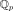
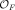
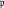
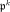
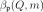
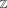
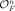
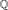

# Further results

Short statements of further results in the repository, each with its Lean names. Every theorem listed here is checked by the Lean kernel with only the standard axioms and depends on no unproved input, except where a hypothesis is named explicitly.

## Isotropy in dimension at least 5 over local fields

**Statement.** Every nondegenerate quadratic form in at least $`5`$ variables over a p-adic field  is isotropic. The same holds over the completion $`F_v`$ of a number field $`F`$ at every finite place $`v`$, dyadic places included.

**In Lean.**
- `QuadFormsKB.isotropic_padic_of_five_le`: over , for forms with rational coefficients, every prime $`p`$.
- `QuadFormsKB.LocalRankFive.isotropic_five`: rank $`5`$ over every non-archimedean completion of a number field.
- `QuadFormsKB.Lattices.isotropicIn_adicCompletion_of_five_le`: rank $`n \ge 5`$ over every non-archimedean completion of a number field.

## Jordan decompositions over discrete valuation rings, and local densities

**Statement.** Let $`R`$ be a discrete valuation ring with uniformizer $`\pi`$ and $`2 \ne 0`$ in $`R`$. Every nondegenerate quadratic form over $`R`$ has the same representation counts modulo every power of $`\pi`$ as a form in Jordan normal form: an orthogonal sum of scaled rank-one forms and scaled binary blocks, with binary blocks needed only when $`\pi`$ divides $`2`$. At ramified dyadic primes the normal form records, for each binary block, both its norm exponent and its scale exponent; the classical normal form (Hanke 2004, Lemma 2.1) can fail there, and the two agree whenever $`\pi^2`$ does not divide $`2`$. For a nondegenerate form over , $`F`$ a number field, and every prime  (dyadic included), the normalized counts modulo  are eventually constant, so the local density  exists for every nonzero $`m`$.

**In Lean.**
- `QuadFormsKB.LocalDensity.DVR.exists_jordanFormW`: the corrected normal form over a discrete valuation ring; `QuadFormsKB.LocalDensity.NF.exists_jordanFormW`: over the completion of  at .
- `QuadFormsKB.LocalDensity.DVR.localDensity_eventually_eq`, `QuadFormsKB.LocalDensity.NF.localDensity_eventually_eq`, `QuadFormsKB.LocalDensity.NF.tendsto_localDensity`: existence of the local density at every prime.
- `QuadFormsKB.LocalDensity.localDensity_eventually_eq`: the same over , at every prime $`p`$.

## Finiteness of the class number

**Statement.** Over , the genus of every positive definite integral quadratic form contains only finitely many classes; the proof is Hermite reduction. Over a number field $`F`$, for every nondegenerate form (definite or indefinite) and every lattice $`L`$ (integral or not), the genus of $`L`$ contains only finitely many classes.

**In Lean.**
- `QuadFormsKB.Siegel.genusFinite`: over ; `QuadFormsKB.Siegel.Hermite.exists_hermite_bound`: Hermite's bound.
- `QuadFormsKB.Lattices.genusClasses_finite`: totally positive definite forms over a totally real field, by Hermite reduction of the trace form.
- `QuadFormsKB.Lattices.ClassFin.genusClasses_finite_nf`: every nondegenerate form and every lattice over every number field.

## Strong approximation for spin groups, and Kneser neighbours

**Statement.** Let $`F`$ be a number field and $`Q`$ a nondegenerate form over $`F`$ in $`n \ge 3`$ variables. Write $`\mathrm{O}'`$ for the kernel of the spinor norm on the rotations, the image of the spin group.
- If $`Q`$ is indefinite (isotropic at some infinite place), then for every lattice $`L`$ every finite adelic element of $`\mathrm{O}'`$ is the product of a global element of $`\mathrm{O}'(V)`$ and an element stabilizing every completion of $`L`$. Consequently (Eichler) two lattices in the same spinor genus are isometric.
- If $`Q`$ is isotropic at a finite prime , the same holds with the stabilizer condition imposed only at the primes other than .
- Kneser's neighbour method: let π ∈  be a prime element not dividing $`2`$, with $`Q`$ isotropic at π and $`L`$ integral and unimodular at π. Every lattice in the spinor genus of $`L`$ is isometric to one reached from $`L`$ by a chain of π-neighbours. Hence, when the genus of $`L`$ is a single spinor genus, the neighbour graph reaches every class of the genus.

**In Lean.**
- `QuadFormsKB.Lattices.strongApproximationSpin`: strong approximation for indefinite forms, every number field.
- `QuadFormsKB.Lattices.eichler_spinorGenus_eq_class_uncond`: spinor genus equals class for indefinite forms in $`n \ge 3`$ variables.
- `QuadFormsKB.Lattices.strongApproximationSpinAt`: strong approximation away from one finite prime  at which $`Q`$ is isotropic.
- `QuadFormsKB.Lattices.kneser_reach_uncond`, `QuadFormsKB.Lattices.kneser_reach_genus_uncond`: Kneser's theorem. In rank $`n \ge 5`$ the isotropy hypothesis is automatic (`QuadFormsKB.Lattices.kneser_reach_uncond_of_five_le`).

## The genus of 𝒪<i>F</i><i>n</i> is free

**Statement.** For every number field $`F`$ and every nondegenerate form $`Q`$ on $`F^n`$, every lattice in the genus of  is free, that is, the image of  under some $`\gamma`$ in the general linear group of $`F^n`$; the Steinitz class is a genus invariant. No hypothesis on the class number.

**In Lean.** `QuadFormsKB.HilbertModular.genusFree_of_nondegenerate`; for totally positive definite forms over , `QuadFormsKB.HilbertModular.genusFree_formF`.

## The Hasse norm theorem for quadratic extensions

**Statement.** Let $`F`$ be a number field and $`a, b \in F^\times`$. If the Hilbert symbol $`(a,b)_v`$ is $`1`$ at every place $`v`$, then $`(a,b) = 1`$ over $`F`$. Equivalently, if $`a`$ is not a square, an element of $`F^\times`$ that is a norm from every completion of $`F(\sqrt{a})`$ is a norm from $`F(\sqrt{a})`$. The proof uses Chevalley's algebraic second inequality and no imported class field theory.

**In Lean.** `QuadFormsKB.HasseNorm.hilbert_eq_one_of_everywhere`; the core case, $`a`$ in , is `QuadFormsKB.HN.hasse_norm_integral`.

## Dirichlet's class number formula and binary Siegel over ℚ

**Statement.**
- For a fundamental discriminant $`D \ne 1`$ with Kronecker character $`\chi_D`$, class number $`h(D)`$, number of roots of unity $`w(D)`$ and regulator $`R(D)`$: $`L(1,\chi_D) = 2\pi h(D)/(w(D)\sqrt{-D})`$ if $`D < 0`$, and $`L(1,\chi_D) = 2h(D)R(D)/\sqrt{D}`$ if $`D > 0`$.
- Siegel's formula for every positive definite binary quadratic form $`f`$ over , of every discriminant $`k^2 D_0`$ with $`D_0`$ fundamental (primitive or not), and every integer $`m \ge 1`$: the genus average of the representation numbers of $`m`$, with weights $`1/\lvert \mathrm{O}(f') \rvert`$, equals $`\tfrac12`$ times the archimedean density times $`L(1,\chi_{D_0})^{-1}`$ times the absolutely convergent product of the corrected local densities.
- The natural-order Euler product at $`s = 1`$: for every nontrivial Dirichlet character $`\chi`$, the partial products of $`(1 - \chi(p)/p)`$ over the primes $`p < N`$ tend to $`L(1,\chi)^{-1}`$. The proof is elementary (a Mertens-type bound and an Abelian argument; no prime number theorem). Consequently, for $`D < 0`$ fundamental, the product of the local densities converges in the natural order of the primes and Siegel's binary formula holds with that product.

**In Lean.**
- `QuadFormsKB.Binary.classNumberFormula_neg`, `QuadFormsKB.Binary.classNumberFormula_pos`: Dirichlet's class number formula.
- `QuadFormsKB.Tamagawa.BinaryAllRat.siegelFormula_binary_all`: binary Siegel over , every discriminant; `QuadFormsKB.Binary.siegelFormula_binary`: the case of a fundamental discriminant.
- `QuadFormsKB.Binary.EulerOne.tendsto_prod_primesBelow`, `QuadFormsKB.Binary.eulerProductAtOne`: the Euler product at $`s = 1`$ in the natural order; `QuadFormsKB.Binary.exists_siegelFormula_binary_natural'`: binary Siegel with the natural-order product.
- Over a totally real field, binary Siegel with the regularized product is unconditional (`QuadFormsKB.Tamagawa.siegelFormula_binary_totallyReal`). The natural-order version `QuadFormsKB.Tamagawa.siegelFormula_binary_totallyReal_natural` is **conditional** on `QuadFormsKB.RegProd.NaturalOrderEulerOne`, the analogue of the Euler product at $`s = 1`$ for the Hecke character, which is not proved over a general totally real field.

## Sums of squares

**Statement.**
- Fermat: a prime $`p \equiv 1 \pmod 4`$ is a sum of two squares.
- Lagrange: every natural number is a sum of four squares.
- Legendre: a natural number is a sum of three squares if and only if it is not of the form $`4^a(8b + 7)`$.
- Davenport–Cassels: let $`Q`$ be a positive definite integral quadratic form such that every rational vector $`x`$ has an integral vector $`y`$ with $`Q(x - y) < 1`$. If $`Q`$ represents an integer $`n`$ over , it represents $`n`$ over .

**In Lean.** `QuadFormsKB.Grosswald.fermat_two_squares` and `QuadFormsKB.Grosswald.lagrange_four_squares` (from Mathlib), `QuadFormsKB.Grosswald.legendre_three_squares` (via Hasse–Minkowski over  and Davenport–Cassels), `QuadFormsKB.DavenportCassels.davenport_cassels`.

## Theta inversion over totally real number fields

**Statement.** Let $`F`$ be a totally real number field of degree $`d`$ and $`L = \bigoplus_i I_i e_i`$ a lattice with fractional ideals $`I_i`$ and a totally positive definite Gram matrix $`A`$ of size $`n`$. For $`z`$ with positive imaginary part at every real place, the theta series of $`L`$ at $`-1/z`$ equals an explicit factor times the theta series of the dual lattice with the dual form $`\tfrac14 \mu^{\mathsf T} A^{-1} \mu`$ at $`z`$. The factor is $`\prod_v (-i z_v/2)^{n/2}`$ divided by $`\prod_v \sqrt{\det A_v}`$ and by the covolumes of the $`I_i`$. For a form over  the covolume factor is $`d_F^{-n/2}`$. As an application, in even rank $`n = 2k`$ the theta series of a totally positive definite form over  is a Hilbert modular form of weight $`k`$ for a congruence subgroup of level 𝔑 with a quadratic character.

**In Lean.** `QuadFormsKB.HilbertModular.thetaLat_inversion`, `QuadFormsKB.HilbertModular.thetaQ_inversion`, and the modularity statement `QuadFormsKB.HilbertModular.thetaQ_mem_modularFormChar'`.

## References

- J.-P. Serre, *A Course in Arithmetic*, Springer GTM 7, 1973, Ch. IV and its appendix [unverified locator for the appendix].
- O. T. O'Meara, *Introduction to Quadratic Forms*, Springer, 1963: 63:19, §65, §82, 103:4, 104:3–104:5 [unverified locator].
- M. Kneser, *Klassenzahlen definiter quadratischer Formen*, Arch. Math. 8 (1957), Satz 2 [unverified locator].
- M. Eichler, *Quadratische Formen und orthogonale Gruppen*, Springer, 1952 [unverified locator].
- J. Hanke, *Local densities and explicit bounds for representability by a quadratic form*, Duke Math. J. 124 (2004), Lemma 2.1, p. 355 (corrected here at ramified dyadic primes) and (5.2), p. 368.
- J. W. S. Cassels, *Rational Quadratic Forms*, Academic Press, 1978, Ch. 9 and Ch. 12 [unverified locator].
- H. Davenport, *Multiplicative Number Theory*, 3rd ed., Springer GTM 74, 2000, Ch. 6 [unverified locator].
- H. L. Montgomery and R. C. Vaughan, *Multiplicative Number Theory I*, Cambridge, 2007, §4.3 [unverified locator].
- E. Grosswald, *Representations of Integers as Sums of Squares*, Springer, 1985, Ch. 2–4 [unverified locator].
- E. Freitag, *Hilbert Modular Forms*, Springer, 1990, Ch. I, §4 [unverified locator].
- G. Shimura, *On modular forms of half integral weight*, Ann. of Math. 97 (1973), §2 [unverified locator].

Bibliographic entries are in [references.bib](../../references.bib).
