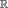
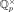

# Hasse–Minkowski over ℚ

A nondegenerate quadratic form over , in any number of variables, is isotropic over  if and only if it is isotropic over  and over every p-adic field . The page also covers the companion results: the local–global principle for isometry, and the classification of quadratic forms over  by dimension, discriminant and Hasse invariant.

## Statement

Let $`Q`$ and $`R`$ be nondegenerate quadratic forms over  in $`n`$ variables.

1. **Isotropy.** $`Q`$ is isotropic over  if and only if it is isotropic over  and over  for every prime $`p`$.
2. **Representation.** For $`c \ne 0`$ in , $`Q`$ represents $`c`$ over  if and only if it represents $`c`$ over  and over every .
3. **Isometry.** $`Q`$ and $`R`$ are isometric over  if and only if they are isometric over  and over every .
4. **Classification over ℚp.** For nonzero rationals $`a_0, \dots, a_{n-1}`$ and $`b_0, \dots, b_{n-1}`$, the diagonal forms $`\langle a_0, \dots, a_{n-1}\rangle`$ and $`\langle b_0, \dots, b_{n-1}\rangle`$ are isometric over the p-adic field  if and only if $`\prod_i a_i`$ and $`\prod_i b_i`$ lie in the same square class of  and their Hasse invariants agree.

Here the Hasse invariant is Serre's $`\varepsilon = \prod_{i<j} (a_i, a_j)_p`$, with $`(\cdot,\cdot)_p`$ the Hilbert symbol of .

## Scope and hypotheses

- Every number of variables $`n`$. Nondegenerate means that the Hessian matrix (twice the Gram matrix) has nonzero determinant.
- Every prime $`p`$, including $`p = 2`$.
- The classification is stated for diagonal forms with rational coefficients, compared over ; every nondegenerate form over  is isometric over  to such a form.
- The other conventions for the Hasse invariant in the literature (O'Meara's $`\prod_{i \le j}`$, Cassels, Lam, Shimura) are defined separately, converted into each other exactly, and each is shown to be an isometry invariant satisfying the product formula over all places of .

## In Lean

All unconditional:

- `QuadFormsKB.hasseMinkowski`: isotropy.
- `QuadFormsKB.represents_iff_everywhere`: representation.
- `QuadFormsKB.isometric_iff_everywhere`: isometry.
- `QuadFormsKB.isometric_padic_iff`: classification over  (proved as `QuadFormsKB.isometric_padic_iff_invariants`); `QuadFormsKB.hasseInvariant_isometric`: invariance of the Hasse invariant.
- `QuadFormsKB.isSquare_iff_everywhere`, `QuadFormsKB.hilbert_product_formula`, `QuadFormsKB.isotropic_padic_of_five_le`: the local–global principle for squares, Hilbert reciprocity over , and isotropy of forms in at least $`5`$ variables over .
- `QuadFormsKB.hasseOMeara_eq`, `QuadFormsKB.RatPlace.hasseOMeara_isometric`, `QuadFormsKB.hasseSerre_product_formula`, `QuadFormsKB.hasseOMeara_product_formula` (and the analogues for Cassels, Lam and Shimura): the Hasse invariant conventions.
- `QuadFormsKB.hasseMinkowski_nf_rat`: the case $`F`$ =  of [Hasse–Minkowski over number fields](hasse-minkowski-number-fields.md), through the identification of the places of .

## Proof outline

The proof follows Serre's *A Course in Arithmetic*, Ch. IV. The local theory gives the squares of , explicit formulas for the Hilbert symbol at odd $`p`$ and at $`p = 2`$, bimultiplicativity, and the product formula. Rank $`2`$ is the local–global principle for squares, and rank $`3`$ is Legendre's theorem. Rank $`4`$ uses a common value of two binary forms chosen with prescribed Hilbert symbols, which needs Dirichlet's theorem on primes in progressions. Rank $`n \ge 5`$ uses isotropy over every  and induction. Representation follows from isotropy of $`Q \perp \langle -c\rangle`$, and isometry from representation and Witt cancellation over  and . In the classification over , invariance of $`\varepsilon`$ is proved by induction with Witt cancellation instead of Witt's chain-equivalence theorem. The converse uses the local representation criterion (Serre IV, §2.2, Thm 6).

## References

- J.-P. Serre, *A Course in Arithmetic*, Springer GTM 7, 1973: Ch. IV, §3.2, Thm 8 (Hasse–Minkowski) and Cor. 1; §3.3, Thm 9 (isometry); §2.3, Thm 7 (classification over ); §2.2, Thm 6; Ch. III, §2.1, Thm 3 (product formula).
- J. W. S. Cassels, *Rational Quadratic Forms*, Academic Press, 1978 [unverified locator].
- O. T. O'Meara, *Introduction to Quadratic Forms*, Springer, 1963 [unverified locator].
- G. Shimura, *Arithmetic of Quadratic Forms*, Springer, 2010, §28.13 [unverified locator].

Bibliographic entries are in [references.bib](../../references.bib). See also [Witt's theorems](witt.md).
