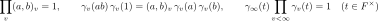

# Hilbert reciprocity over number fields

For every number field $`F`$ and all nonzero $`a, b \in F`$, the local Hilbert symbols $`(a,b)_v`$ equal $`1`$ at all but finitely many places $`v`$, and their product over all places is $`1`$. The proof is purely local in its arithmetic input: it uses the Weil index of the character of second degree $`x \mapsto \psi_v(tx^2)`$ and adelic Poisson summation, and no class field theory.

## Statement

Let $`F`$ be a number field and $`a, b \in F^\times`$. Then the set of places $`v`$ of $`F`$ (finite and infinite) with $`(a,b)_v = -1`$ is finite and has an even number of elements; that is, the first identity below holds. The proof rests on the other two.

## Notation

| Symbol | Meaning |
|---|---|
| $`(a,b)_v`$ | the Hilbert symbol of the completion $`F_v`$: $`1`$ if $`a x^2 + b y^2 = z^2`$ has a nonzero solution in $`F_v`$, else $`-1`$ |
| $`\psi_v`$ | the local component of a fixed nontrivial additive character of the adeles of $`F`$, trivial on $`F`$ |
| $`\gamma_v(t)`$ | the unnormalized Weil constant of $`x \mapsto \psi_v(t x^2)`$: a Gauss integral over a large ball at a finite place, and an explicit Fresnel value at a real or complex place |
| $`\gamma_\infty(t)`$ | the product of the $`\gamma_v(t)`$ over the infinite places |

## Scope and hypotheses

- Every number field $`F`$; no hypothesis on the degree, the signature or the class number.
- Every place, including the dyadic places and the real and complex places.
- Over  there is a second, independent proof by Serre's explicit formulas for the Hilbert symbol.

## In Lean

All unconditional:

- `QuadFormsKB.hilbert_reciprocity_nf`: Hilbert reciprocity over every number field, in the form "finite and of even cardinality".
- `QuadFormsKB.HN.hilbert_product_formula_nf`: the same statement, where it is proved.
- `QuadFormsKB.HN.weilV_mul_identity`, `QuadFormsKB.HN.weilR_mul_identity`, `QuadFormsKB.HN.weilC_mul_identity`: the local identity $`\gamma_v(ab)\gamma_v(1) = (a,b)_v\gamma_v(a)\gamma_v(b)`$ at finite (dyadic included), real and complex places.
- `QuadFormsKB.Analysis.weilInf_mul_finprod_weilV`: Weil's product formula $`\gamma_\infty(t)\prod_v \gamma_v(t) = 1`$ for $`t \in F^\times`$.
- `QuadFormsKB.hilbert_product_formula`: Hilbert reciprocity over , by Serre's route.
- `QuadFormsKB.hilbert_reciprocity_nf_rat`: the case $`F`$ =  of the number-field statement, through the identification of the places.

## Proof outline

At each place $`v`$ the Weil constant $`\gamma_v(t)`$ is computed as a Gauss integral. The local identity $`\gamma_v(ab)\gamma_v(1) = (a,b)_v\gamma_v(a)\gamma_v(b)`$ follows from the characterization of $`(a,\cdot)_v`$ as the character whose kernel is the norm group of $`F_v(\sqrt{a})`$, the local square theorem, and a change of variables in the Gauss integral. The global product formula comes from adelic Poisson summation for a Gaussian test function Φ twisted by $`\psi(t x^2)`$: the sum of Φ over $`F`$ equals the sum of its Fourier transform over $`F`$, and evaluating both sides gives $`\gamma_\infty(t)\prod_v\gamma_v(t) = 1`$. Multiplying the local identity over all places and applying the product formula to $`ab`$, $`1`$, $`a`$ and $`b`$ leaves $`\prod_v (a,b)_v = 1`$. Finiteness of the set of places with $`(a,b)_v = -1`$ holds because $`a`$ and $`b`$ are units at all but finitely many odd places.

## Related work

Tau Ceti proves Hilbert reciprocity over every number field as `hilbertProductFormula` ([`NumberTheory/ClassFieldTheory/Global/Hilbert/Reciprocity.lean`](https://github.com/TauCetiProject/TauCeti/blob/main/TauCeti/NumberTheory/ClassFieldTheory/Global/Hilbert/Reciprocity.lean)), through class field theory and the sum formula for the Brauer group. The proof here is different and purely local: it uses the Weil index of a quadratic character and adelic Poisson summation, and imports no class field theory.

## References

- A. Weil, *Sur certains groupes d'opérateurs unitaires*, Acta Math. 111 (1964), §§22–28 [unverified locator].
- J.-P. Serre, *A Course in Arithmetic*, Springer GTM 7, 1973, Ch. III, §2.1, Thm 3 (over ).
- O. T. O'Meara, *Introduction to Quadratic Forms*, Springer, 1963, 71:18 [unverified locator].

Bibliographic entries are in [references.bib](../../references.bib). Hilbert reciprocity is an input of the [Hasse–Minkowski theorem over number fields](hasse-minkowski-number-fields.md) in Serre's route.
