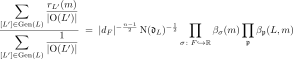
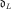
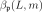
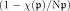

# Siegel's theorem for totally positive definite quadratic lattices representing numbers over totally real number fields

Siegel's theorem expresses the average number of representations of a number by the lattices in a genus as a product of local densities. It is proved here for every totally real number field, every rank, and every genus, including genera of lattices that are not free over .

## Statement

Let $`F`$ be a totally real number field with ring of integers  and discriminant $`d_F`$. Let $`L`$ be a totally positive definite quadratic lattice over  of rank $`n`$ on a quadratic space $`(V, Q)`$ over $`F`$, and let $`m \in`$  be totally positive. For $`n \ge 4`$,

## Notation

| Symbol | Meaning |
|---|---|
| $`\mathrm{Gen}(L)`$ | the isometry classes of lattices in the genus of $`L`$ |
| $`r_{L'}(m)`$ | the number of $`x \in L'`$ with $`Q(x) = m`$ |
| $`\mathrm{O}(L')`$ | the orthogonal group of $`L'`$ (improper isometries included) |
|  | the discriminant ideal of $`L`$ |
|  | the local density of $`L`$ at the prime , for the Haar measure giving the completion of $`L`$ at  volume $`1`$ |
| $`\beta_{\sigma}(m)`$ | the local density at the real place $`\sigma`$, equal to $`\pi^{n/2}\,\sigma(m)^{n/2-1}/\Gamma(n/2)`$ |

Classes are isometry classes under the full orthogonal group, and each class is weighted by $`1/\lvert \mathrm{O}(L') \rvert`$.

## Ranks 1, 2 and 3

In ranks $`2`$ and $`3`$ the product over  does not converge absolutely. It is regularized by the value $`L(1,\chi)`$ of a quadratic Hecke $`L`$-function: the factors  are multiplied by the Euler factors of $`L(s,\chi)`$ at $`s = 1`$, which makes the product absolutely convergent, and the result is divided by $`L(1,\chi)`$. In ranks $`1`$ and $`2`$ the right side carries Siegel's factor $`\tfrac12`$.

Reading the product in the natural order of the primes (partial products over the primes of norm at most $`X`$) gives the same value once one knows that the partial products of  tend to $`L(1,\chi)^{-1}`$ in that order. Over  this convergence is proved for every nontrivial Dirichlet character (see [further results](further-results.md)). Over a general totally real field the natural-order versions are stated with that convergence as a hypothesis.

## Scope and hypotheses

- Every totally real number field $`F`$, of any degree and any class number; $`F`$ =  is included.
- Every genus, including genera of lattices with nontrivial Steinitz class.
- Every totally positive $`m \in`$ . If $`m`$ is not represented by the genus, both sides are $`0`$.
- The space is an abstract quadratic space $`(V, Q)`$ over $`F`$ (Mathlib's `QuadraticForm F V`). The genus, the classes and the mass are defined inside $`V`$, and the local densities and the discriminant do not depend on a choice of basis.

## In Lean

All in the namespace `QuadFormsKB.Tamagawa.SiegelSpace`, unconditional:

- `QuadFormsKB.Tamagawa.SiegelSpace.siegelFormula_quadraticSpace_classical`: rank $`n \ge 4`$, in the form above.
- `QuadFormsKB.Tamagawa.SiegelSpace.siegelFormula3_quadraticSpace_classical'`: rank $`3`$, regularized.
- `QuadFormsKB.Tamagawa.SiegelSpace.siegelFormula2_quadraticSpace_classical'`: rank $`2`$, regularized, with the factor $`\tfrac12`$.
- `QuadFormsKB.Tamagawa.SiegelSpace.siegelFormula1_quadraticSpace_classical`: rank $`1`$.

The natural-order versions in ranks $`3`$ and $`2`$, `siegelFormula3_quadraticSpace_natural_classical'` and `siegelFormula2_quadraticSpace_natural_classical'` (same namespace), are **conditional** on `QuadFormsKB.RegProd.NaturalOrderEulerOne` for the relevant quadratic character.

## Proof outline

The proof follows Weil's adelic approach. The genus average of $`r_{L'}(m)`$ is rewritten as a sum over the orbits of $`\mathrm{O}(Q)(F)`$ on the vectors with $`Q(x) = m`$, and each orbit is a genus of the orthogonal complement $`x^\perp`$, of rank $`n - 1`$. Comparing the masses of $`L`$ and of these complements, and computing the local orbital volumes at every prime (dyadic primes included), turns the average into a quotient of Tamagawa measures. The theorem then follows from $`\tau(\mathrm{SO}(Q)) = 2`$ for the form $`Q`$ of rank $`n`$ and for the forms of rank $`n - 1`$ on the orthogonal complements (see [Tamagawa number and mass formula](tamagawa-mass-formula.md)). The theorem is first proved for the free lattice  with a form over . It is then transferred to an arbitrary lattice through local free models and the change-of-lattice formula for local densities, and to an abstract space $`(V, Q)`$ by showing that every term is independent of the chosen basis.

## References

- C. L. Siegel, *Über die analytische Theorie der quadratischen Formen*, Ann. of Math. 36 (1935), Hauptsatz [unverified locator].
- A. Weil, *Adeles and Algebraic Groups*, Birkhäuser, 1982, §4.5, Thm 4.5.1 [unverified locator].
- Y. Kitaoka, *Arithmetic of Quadratic Forms*, Cambridge, 1993, §6.8 [unverified locator].

Bibliographic entries are in [references.bib](../../references.bib).
