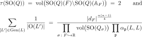
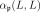
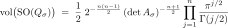
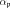
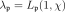
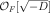

# Tamagawa number and mass formula over totally real number fields

For a totally positive definite quadratic space $`V`$ of dimension $`n \ge 3`$ over a totally real number field $`F`$, the Tamagawa number of the special orthogonal group is $`2`$. Equivalently, the mass of every genus of totally positive definite quadratic lattices over  on $`V`$ is the inverse of an explicit product of local volumes (the Smith–Minkowski–Siegel mass formula). Rank $`2`$ is covered with Weil's regularized (convergence-factor) Tamagawa measure.

## Statement

Let $`F`$ be a totally real number field with discriminant $`d_F`$, let $`(V, Q)`$ be a totally positive definite quadratic space over $`F`$ of dimension $`n \ge 3`$, and let $`L`$ be a totally positive definite quadratic lattice over  on $`V`$. Then

## Notation

| Symbol | Meaning |
|---|---|
| $`\tau(\mathrm{SO}(Q))`$ | the covolume of $`\mathrm{SO}(Q)(F)`$ in the adelic group, for the Tamagawa measure |
| $`\mathrm{Gen}(L)`$ | the isometry classes of lattices in the genus of $`L`$ |
| $`\mathrm{O}(L')`$ | the orthogonal group of $`L'`$ (improper isometries included) |
| $`\mathrm{vol}(\mathrm{SO}(Q_\sigma))`$ | the gauge-form volume of the compact group $`\mathrm{SO}(Q_\sigma)`$, where $`Q_\sigma`$ is $`Q`$ over the real place $`\sigma`$, given in closed form below |
|  | Siegel's local density, $`\tfrac12`$ of the local density of $`L`$ by itself; it is the volume of the special orthogonal group of the completion of $`L`$ at  |

The left side of the mass formula is the mass of $`L`$: classes are isometry classes under the full orthogonal group, weighted by $`1/|\mathrm{O}(L')|`$. If $`A_\sigma`$ is a Gram matrix of $`L`$ at $`\sigma`$, so that $`Q(x) = x^{\mathsf T} A_\sigma x`$, then

The product over  converges absolutely for $`n \ge 3`$.

## Scope and hypotheses

- Every totally real number field, of any degree and any class number; $`F`$ =  is included.
- In Lean the space is $`F^n`$ with a totally positive definite form $`Q_0`$ whose coefficients lie in . Every totally positive definite space has such a basis (scale a basis by an integer). The Tamagawa number does not depend on the lattice.
- The mass formula is proved for the genus of  in every rank $`n \ge 3`$, and for the genus of an arbitrary lattice (any Steinitz class) on $`V`$.
- **Rank 2.** The plain product of the  diverges. With Weil's convergence factors , the regularized Tamagawa number of $`\mathrm{SO}(Q)`$ is $`2`$ for every totally positive definite binary form over .
- **Rank 1.** $`\mathrm{SO}(Q)`$ is trivial and its Tamagawa number is $`1`$.
- The adelic statement uses a genuine Haar measure on the adelic points of $`\mathrm{SO}(Q)`$. It is proved equal to the product of the local volumes times the mass, so $`\tau = 2`$ is not a reformulation of the mass formula.

## In Lean

Unconditional:

- `QuadFormsKB.Tamagawa.Measure.Weil.tamagawaNumberTwo_all_ranks_totallyReal`: $`\tau(\mathrm{SO}(Q)) = 2`$, rank $`n \ge 4`$, every totally real $`F`$.
- `QuadFormsKB.Tamagawa.tamagawaNumberTwo_ternary_nf`: rank $`3`$, every totally real $`F`$.
- `QuadFormsKB.Tamagawa.Measure.Weil.massFormula_all_ranks_totallyReal`: the mass formula for the genus of , rank $`n \ge 4`$.
- `QuadFormsKB.Tamagawa.massFormula_lat_ternary_nf`: the mass formula for the genus of an arbitrary ternary lattice.
- `QuadFormsKB.Tamagawa.binaryTamagawaTwoReg_nf`: the regularized Tamagawa number is $`2`$ in rank $`2`$.
- `QuadFormsKB.Tamagawa.TauSOOne.tauSO_rankOne_eq_one`: rank $`1`$.
- `QuadFormsKB.Tamagawa.Measure.tamagawaNumberTwo_iff_covolume` and `QuadFormsKB.Tamagawa.Measure.Weil.tamagawaNumberTwoAdelic_iff`: the identification of $`\tau`$ with the covolume for the Tamagawa measure; `QuadFormsKB.Tamagawa.Measure.Weil.tamagawaNumberTwoAdelic_ternary` is the adelic form in rank $`3`$.
- `QuadFormsKB.Tamagawa.Measure.Weil.quaternaryTamagawaTwo_nf'` and `QuadFormsKB.Tamagawa.Measure.Weil.rankFourUnitSiegel_nf`: rank $`4`$, the base of the induction.
- `QuadFormsKB.Tamagawa.mass_eq_dcMass`, `QuadFormsKB.Tamagawa.mass_SO_eq_two_mul_mass`, `QuadFormsKB.Tamagawa.volSO_eq`, `QuadFormsKB.Tamagawa.ArchVol.archVolSO_eq_volume`: the mass as an adelic volume, the local volumes and the archimedean volume.
- `QuadFormsKB.Tamagawa.e8_mass_check`: over , the right side for $`E_8`$ equals $`1/696729600`$, the inverse of the order of the Weyl group of $`E_8`$.

For an arbitrary lattice in rank $`n \ge 4`$, `QuadFormsKB.Tamagawa.massFormula_lat_all_ranks_nf` is stated with the hypothesis `QuadFormsKB.Tamagawa.RankFourUnitSiegel F`. That hypothesis is proved for every totally real $`F`$ by `rankFourUnitSiegel_nf` above, so the combination is unconditional.

## Proof outline

The proof follows Weil's *Adeles and Algebraic Groups*. The mass of a genus is the volume of the quotient of the finite adelic points of $`\mathrm{O}(Q)`$ by $`\mathrm{O}(Q)(F)`$ divided by the volume of the stabilizer of $`L`$, and the volume of the special orthogonal group of the completion of $`L`$ at  is  at every prime, dyadic primes included. In rank $`3`$, $`\mathrm{SO}(Q) \cong D^\times/F^\times`$ for a totally definite quaternion algebra $`D`$, and $`\tau = 2`$ comes from the zeta function of a maximal order and Eichler's mass formula, with the local factors computed at the ramified and dyadic primes. In rank $`4`$, $`\mathrm{SO}(Q)`$ is described through a quaternion algebra over the discriminant extension $`F(\sqrt{d})`$, and Weil's comparison of Tamagawa measures gives $`\tau = 2`$. Higher ranks follow by Weil's induction on the dimension: fibre $`\mathrm{SO}(Q)`$ over the vectors with $`Q(x) = m`$, prove the local orbital identity at every prime, and assemble the Euler product. Rank $`2`$ comes from the mass formula of the order  in the CM extension $`F(\sqrt{-D})/F`$ and the relative class number formula.

## References

- A. Weil, *Adeles and Algebraic Groups*, Birkhäuser, 1982, §2.4, §3.7 (Thm 3.7.1) and §4.5 (Thm 4.5.1) [unverified locator].
- C. L. Siegel, *Über die analytische Theorie der quadratischen Formen*, Ann. of Math. 36 (1935) [unverified locator].
- Y. Kitaoka, *Arithmetic of Quadratic Forms*, Cambridge, 1993, §5.6 and §6.8 [unverified locator].
- J. H. Conway and N. J. A. Sloane, *Low-dimensional lattices IV: the mass formula*, Proc. Roy. Soc. London A 419 (1988), Table 2 [unverified locator].
- J. Voight, *Quaternion Algebras*, Springer GTM 288, 2021 [unverified locator].

Bibliographic entries are in [references.bib](../../references.bib). Related: [Siegel's theorem](siegel-totally-real.md).
